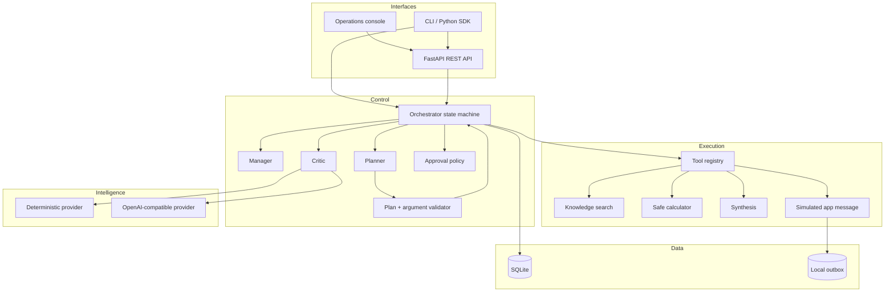
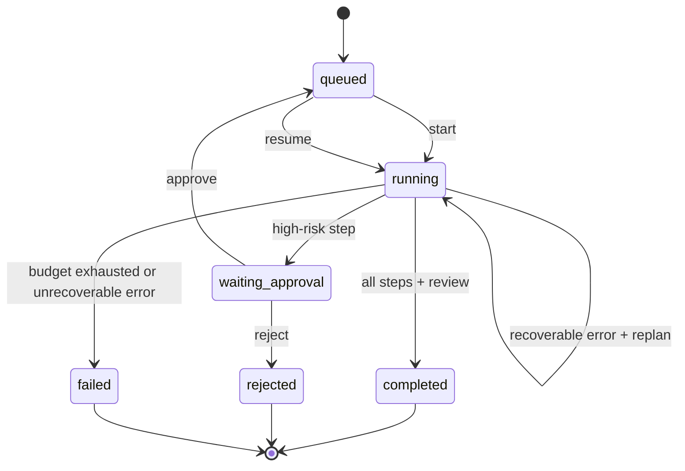

# Architecture

## Design goals

The architecture favors explicit state and small trust boundaries. “Agent” describes a bounded role in a workflow; it does not imply unlimited authority, recursive spawning, or unrestricted tool access.

## Components

## Run state machine

Terminal runs are immutable through the public orchestration flow. Completed steps are skipped on
resume. The simulated message connector also derives a stable idempotency key from the run and exact
step ID, so a repeated invocation returns the original artifact instead of writing a duplicate.

## Data model

| Table | Purpose | Notable fields |
|---|---|---|
| `runs` | Objective and top-level lifecycle | status, context, result, error, timestamps |
| `steps` | Ordered execution plan | agent, tool, validated arguments, risk, status, output |
| `events` | Append-only operational trace | event type, actor, JSON payload, timestamp |
| `memories` | Cross-run lessons | objective key, lesson, quality score, source run |

SQLite is adequate for a single-node evaluator. A production evolution would use PostgreSQL for state, a queue such as Redis/SQS for workers, and object storage for large artifacts.

## Agent contracts

- **Manager:** owns the objective and delegation strategy; cannot call application tools directly.
- **Planner:** requests typed steps from the configured provider, validates the tool and arguments,
  repairs an invalid plan once, and otherwise uses the deterministic fallback.
- **Researcher/analyst/writer/operator:** execution identities recorded on each step.
- **Critic:** verifies draft grounding before high-risk messaging, allows one writer revision, and
  evaluates the completed run before writing lesson memory.

## Tool contract

Each tool has a unique name, description, declared risk, a strict Pydantic argument schema, one
structured input context, and JSON-serializable output. A tool cannot choose its own authority. The
orchestrator validates model-proposed arguments and evaluates risk before invocation. A message
recipient supplied by the user is pinned and cannot be replaced by the planner.

Current tools:

| Tool | Side effect | Risk |
|---|---|---|
| `knowledge.search` | None | Low |
| `data.calculate` | None; safe AST subset | Low |
| `content.synthesize` | None | Low |
| `app.message` | Writes a local outbox artifact | High |

## Self-improvement loop

“Self-improving” is implemented as bounded episodic memory:

1. Critic calculates a transparent quality score.
2. Critic records a lesson with its source run and objective keywords.
3. A later related objective retrieves up to three qualifying lessons using BM25 ranking.
4. Manager includes them in delegation context.

This approach is reversible and auditable. It avoids autonomous prompt/code changes, reward hacking, and silent policy drift.

## Failure handling

Tool exceptions become durable `step.failed` observations. The planner may rebuild only the
remaining work up to two times while preserving completed steps and the global eight-attempt budget.
If recovery fails or the budget is exhausted, the run becomes `failed` with a `run.failed` event.
OpenAI-compatible requests use three attempts with exponential backoff. Simulated messages are safe
against duplicate writes through their run-and-step idempotency key.

## Scaling path

1. Replace in-process background tasks with a durable queue and leased workers.
2. Migrate SQLite to PostgreSQL with optimistic concurrency/version columns.
3. Add OIDC, tenant IDs, RBAC, encrypted secrets, and per-tool scopes.
4. Extend local idempotency to transactional connector outboxes, rate limits, and dead-letter queues.
5. Add OpenTelemetry traces, cost/token budgets, evaluation sampling, and alerts.

